<table>
  <tr>
    <td align="center"></td>
    <td align="center"></td>
  </tr>
</table>

## 🌐 Socials

<picture>
  <source media="(prefers-color-scheme: dark)" srcset="https://raw.githubusercontent.com/kasidit001/kasidit001/output/github-contribution-grid-snake-dark.svg">
  <source media="(prefers-color-scheme: light)" srcset="https://raw.githubusercontent.com/kasidit001/kasidit001/output/github-contribution-grid-snake.svg">
  
</picture>

The three terminal panels above are animated SVGs generated by `scripts/` (no third-party services, no token) and refreshed daily by GitHub Actions.
